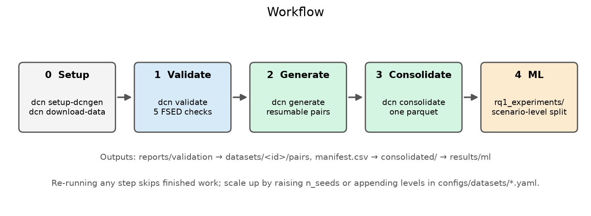
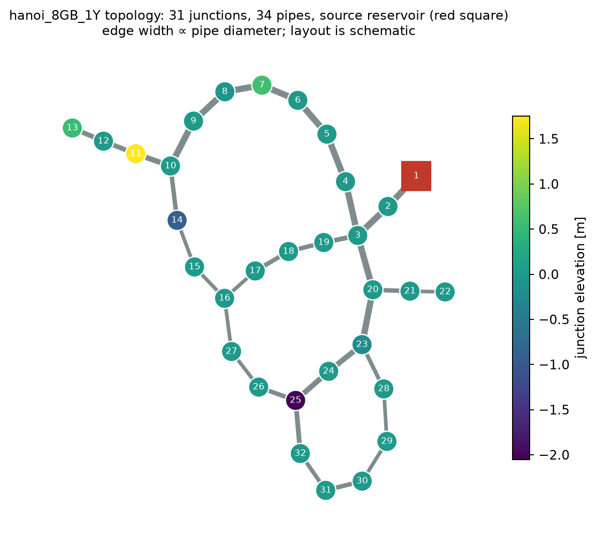
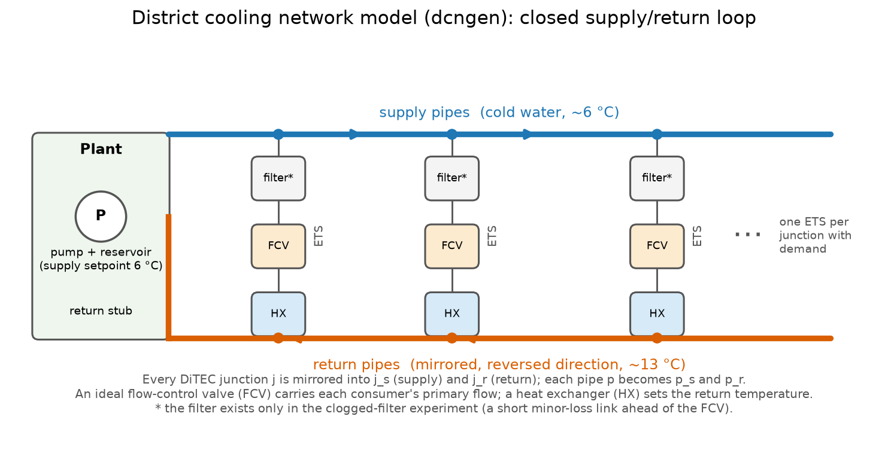
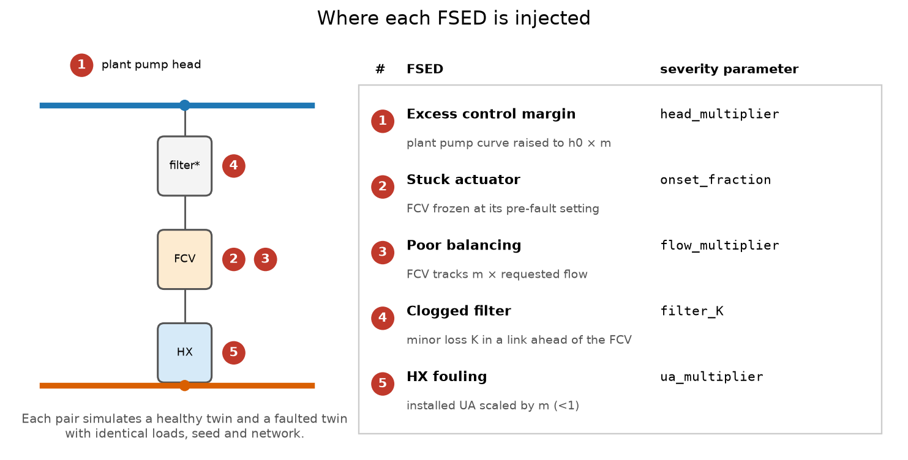

# District cooling network

Synthetic district-cooling fault data built on [dcngen](https://github.com/asgersong/dcngen): validated
fault mechanisms, a resumable dataset generator, and the thesis experiments. Runs unchanged on Google Colab
and on a Linux CPU server.



## The network

dcngen turns a water-distribution network (DiTEC-WDN, here `hanoi_8GB_1Y`: 31 junctions, 34 pipes, one source)
into a closed supply/return district-cooling loop. Each junction with demand gets one energy transfer
station (ETS): a flow-control valve (FCV) and a heat exchanger (HX).

<p align="center"></p>



## Fault modelling (the five FSEDs)

Each dataset item is a **pair**: a healthy twin and a faulted twin with identical loads, seed and network.
The figure shows where each fault enters the model; severities are simulation-defined sensitivity levels.
Physics and assumptions are in [docs/five_fsed_spec.md](docs/five_fsed_spec.md).



## Research questions and where they live

| RQ | Question | Status here |
|---|---|---|
| **RQ1** | Do topology and physics-based constraints improve fault detection/classification versus topology-agnostic baselines? | Data: `export: network` writes every consumer and pipe. Baseline done: `rq1_experiments/baseline_mlp.py` (topology-agnostic MLP, scenario-level split). Topology-aware / physics-constrained models: to be added in `rq1_experiments/`. |
| **RQ2** | How does diagnosis change when two faults occur concurrently at different locations? | Not implemented yet. The generator supports one fault per pair, at chosen locations (`targets:` in the dataset spec). A multi-fault spec is the next extension; the same ML code then gives the single- vs two-fault comparison. |
| **RQ3** | What architecture and interface does a topology-aware model need inside a digital-twin-as-a-service? | Design question, no code. The stages are separate, file-based and scriptable (`dcn` CLI + `district_cooling_network.ml`); `meta.json` records simulation time per pair and ML runs record config and metrics, useful for the latency/retraining discussion. |

## Quick start

```bash
scripts/setup_server.sh /data/dcn_workspace     # uv sync, build patched dcngen, download inputs, doctor
export SWIM_WORKSPACE=/data/dcn_workspace
uv run --all-extras dcn validate                # 1. check the five FSED mechanisms
uv run --all-extras dcn generate pilot_v1 --workers 16   # 2. resumable generation
uv run --all-extras dcn consolidate pilot_v1             # 3. merge pairs into one parquet
uv run --all-extras python rq1_experiments/baseline_mlp.py --dataset pilot_v1   # 4. baseline
```

Colab: run `notebooks/00_setup.ipynb`, then `01_validation`, `02_dataset_generation`, `03_ml_experiments`.
Each notebook mounts Drive and sets the workspace itself.

| Step | What | Command |
|---|---|---|
| 0 | Set up, build patched dcngen, fetch inputs | `scripts/setup_server.sh` or `notebooks/00_setup.ipynb` |
| 1 | Fault modelling: check each FSED changes the physics | `dcn validate` |
| 2 | Generate data (resumable) | `dcn generate pilot_v1 --workers 16`, `dcn consolidate pilot_v1` |
| 3 | Test one ML method | `rq1_experiments/baseline_mlp.py` |
| 4 | Analyse | `results/validation/`, `results/ml/`, `datasets/<id>/consolidated/` |
| 5 | Scale up | raise `n_seeds`, append levels or `targets` in `configs/datasets/*.yaml`, repeat step 2 (only new pairs run) |

## Folder structure

```
district-cooling-network/
├── README.md, pyproject.toml, uv.lock
├── configs/                  dcngen.lock.yaml (pinned commit + patch hash), dcngen_default.yaml,
│                             inputs.yaml, datasets/<name>.yaml
├── src/district_cooling_network/
│   ├── pipeline/             simulation: network and seed context, the five FSED pair runners, exporters
│   ├── validation/           five physics checks, summary table, figures
│   ├── dataset/              resumable generation and consolidation
│   ├── ml/                   leakage-safe features, group splits, run tracking
│   ├── manifest.py           dataset grid, per-pair status, protected-output registry
│   ├── paths.py, config.py   workspace and config resolution (no hardcoded paths)
│   ├── dcngen_env.py         pinned clone -> patched copy, import bootstrap
│   └── cli.py                the `dcn` command
├── rq1_experiments/          RQ1 scripts (add rq2_experiments/ ... as they start)
├── notebooks/                Colab notebooks 00_setup ... 03_ml_experiments (thin, call the CLI)
├── scripts/                  setup_server.sh, run_generation.sh, make_figures.py
├── patches/                  SWiM extensions to dcngen as a patch, with provenance notes
├── docs/                     five_fsed_spec.md, images/, progress report and thesis PDFs
├── data/                     network inputs (untracked)
├── tests/                    pytest, needs neither dcngen nor data
└── archive/                  original notebook, old scripts, loose dcngen copies (unused; see its README)
```

Generated content goes to the **workspace** (`SWIM_WORKSPACE`; default: this folder; on Colab
`/content/drive/MyDrive/DCN_Thesis`), all untracked:

```
<workspace>/
├── data/ditec-wdn/hanoi_8GB_1Y/    inputs (read-only)
├── external/dcngen/                pristine pinned upstream clone (read-only)
├── external/dcngen_swim/           derived: pristine + patches (built)
├── configs/resolved/dcngen.yaml    rendered config (machine paths)
├── datasets/<id>/                  manifest.csv, spec.yaml, pairs/<pair_id>/, consolidated/, logs/
├── results/validation/, results/ml/
└── reports/validation/             one json + log per validation experiment
```

## Dependencies

Python >= 3.12 (dcngen requires it). Core: numpy, scipy, pandas, pyarrow, networkx, pyyaml, wntr, tabulate.
Extras: `data` (huggingface_hub), `plots` (matplotlib), `ml` (scikit-learn), `dev` (pytest, ruff). No conda;
torch / torch_geometric are not needed for simulation (install CPU torch yourself for GNNs).

```bash
uv sync --all-extras
```

Use `uv run --all-extras ...` (or `.venv/bin/python`) so `uv run` does not drop the extras.

## Commands

| Command | Purpose |
|---|---|
| `dcn paths` / `dcn doctor` | resolved paths / health check (Python, modules, inputs, dcngen build, protected outputs) |
| `dcn setup-dcngen` | clone the pinned dcngen (or reuse one) and build the patched copy |
| `dcn extract-patch <dir>` | turn an in-place modified dcngen clone into the project patch (read-only on `<dir>`) |
| `dcn download-data` | fetch only missing DiTEC-WDN files |
| `dcn validate [names] [--force]` | run validation experiments and write reports |
| `dcn manifest status <ds>` | refresh and show `manifest.csv` |
| `dcn generate <ds> [--workers N] [--shard I/N] [--fsed ...] [--limit N] [--dry-run] [--rebuild-stale]` | generate missing pairs |
| `dcn consolidate <ds>` | merge pairs into one parquet (`export: network` gives `consumers` and `pipes`) |
| `dcn manifest import-legacy --root DIR --label L` / `verify-legacy` | register / re-check existing outputs |

## Inputs and outputs

- **Inputs:** DiTEC-WDN Hanoi files (`configs/inputs.yaml`), dcngen config, dataset spec.
- **Dataset:** per pair, `export: target_table` writes `data.parquet` (target ETS, healthy + fault rows);
  `export: network` writes `{healthy,fault}_{consumers,pipes}.parquet`. `meta.json` holds the spec hash, seeds,
  QA checks, file hashes, host and dcngen commit/patch hashes.
- **Validation:** CSVs and figures in `results/validation/`; per experiment a report with status, fingerprint,
  output hashes and log in `reports/validation/`. Passed experiments are skipped until code, config or dcngen build change.
- **ML:** `results/ml/<name>/<config-hash>/` with `config.yaml`, `metrics.json`, `status.json`.

## Resumability and protection of existing work

- A pair is done when `pairs/<id>/_SUCCESS` exists; pairs are written to a temp folder and renamed into place.
  Re-runs skip done pairs, retry failures (`failures/`), and archive incomplete folders to `pairs_stale/`.
- Pair ids are stable. Append levels at the end of a list or raise `n_seeds`: only new pairs run. Changing
  anything that affects results marks pairs `stale`; they are rebuilt only with `--rebuild-stale`, and the old
  copy is archived.
- `--workers N` starts N shard processes with BLAS pinned to one thread; `--shard I/N` splits across machines
  sharing a workspace.
- **dcngen is never modified.** `external/dcngen` is only read; patches apply to `external/dcngen_swim`.
  `SWIM_DCNGEN_DIR` can point at your existing Drive clone safely.
- **Existing scenario outputs (the 105):** `dcn manifest import-legacy --root <dir> --label scenarios105`
  records path, size and sha256 and counts `_SUCCESS` folders. Writes into that directory become an error, and
  `dcn doctor` / `verify-legacy` flag any changed file. They are never regenerated or renamed.

## ML notes

`district_cooling_network.ml.features` encodes the pilot's leakage rules (no FSED, severity, ids, state or
filter-only channels as inputs; a stuck actuator is faulty only after onset). `split_by_group` holds out whole
scenarios (`pair_id`) or whole seeds. `start_run` gives each config its own result folder and skips finished runs.

## Figures and tests

```bash
uv run --all-extras python scripts/make_figures.py --data <data>/ditec-wdn/hanoi_8GB_1Y   # redraw docs/images
uv run --all-extras pytest && uv run --all-extras ruff check src tests rq1_experiments
```

The network plot reads only the small static DiTEC files; node positions are a graph layout, not coordinates.
